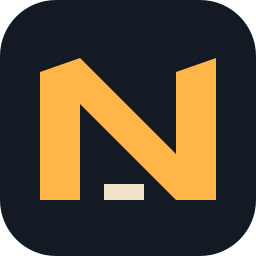
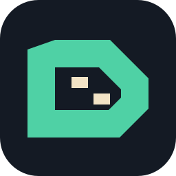

### Hi, I'm Feoren 👋

**Senior full-stack developer.** From code to infrastructure: development, servers,
networking and IT security in one person, plus AI automation and local AI on my own hardware.

20+ years in IT, 15+ of them building software. I build products alone from the first
architecture sketch to running them in production. I build without frameworks whenever I can, and with my own hands from the server to
the last pixel.

---

### 🛩️ The Hangar family

Open-source desktop tools for working with AI coding agents, built to fit together.
Website: [hangar.feoren.com](https://hangar.feoren.com)

| | Project | What it is | Built with |
| :-: | ------- | ---------- | ---------- |
|  | [**Hangar**](https://github.com/feoren/hangar) ✅ Available | One desktop window for all terminal sessions and AI coding agents (Claude Code, Codex CLI, Gemini CLI, Aider). Real PTY, sessions that survive restarts, signed auto-updates, 12 languages. | Rust · Tauri 2 · React · TypeScript |
|  | [**Hangar Server**](https://github.com/feoren/hangar-server) ✅ Available | The team server behind Hangar: relays live presence, task reservations, file claims and end-to-end encrypted notes between AI coding agents and their teammates. Self-hostable with one command. | Rust · axum · SQLite · Docker |
|  | [**Hangar Note**](https://github.com/feoren/hangar-note) ✅ Available | Sticky notes on the desktop, next to Hangar: one window per note, live-styled Markdown, color categories and a tray icon. Takes over Hangar's private and team notes. | Rust · Tauri 2 · React · TypeScript · CodeMirror 6 |
|  | [**Hangar Drive**](https://github.com/feoren/hangar-drive) 🚧 In progress | End-to-end encrypted file sync on your own server: folders stay in sync across all your computers, files are encrypted on the device, and earlier versions are kept. | Rust · Tauri 2 · axum · React · TypeScript · Docker |

---

### 🌐 Websites

Built and run by me, from the server to the last pixel.

| | Website | What it is | Built with |
| :-: | ------- | ---------- | ---------- |
|  | [**feoren.com**](https://www.feoren.com) ✅ Live | My personal website: an animated ASCII city and pixel sea drawn on a single canvas from colored characters, new on every visit. 14 languages, many easter eggs. | PHP 8 (no framework) · Vite · Tailwind CSS · MariaDB |
|  | [**circkool.com**](https://www.circkool.com) ✅ Live | Home of my dark fantasy series: reading sample, newsletter, reader accounts with passkeys, and two Discord bots fed from an admin area. | PHP 8 · React islands · Tailwind CSS · Node.js (discord.js) |
| ⚽ | [**myduell.com**](https://www.myduell.com) 🚧 In progress | A portal for football prediction leagues: scoring, rankings, knockout and league phases, Stripe payments and web push. | PHP 8 · Vite · Tailwind CSS · MariaDB · Playwright |
| 🎲 | [**lottique.com**](https://www.lottique.com) 🚧 In progress | Lottery analytics for Lotto 6aus49 and Eurojackpot: automatic draw import, statistics and charts rendered on the server. | PHP 8 · Bootstrap 5 · MariaDB |

---

### 🧰 Skills

**Languages and frameworks**
Rust · PHP · TypeScript · JavaScript · SQL · Python · HTML · CSS / SCSS · React · Vue.js · Laravel ·
Tauri · Tailwind CSS · Bootstrap

**Data and APIs**
MariaDB / MySQL (schema design, indexing, query tuning) · REST · SOAP · OAuth 2.0 / OIDC ·
WebAuthn · Stripe · Web Push

**Infrastructure and operations**
Linux · Windows Server (AD, DNS) · Nginx · Apache · Docker · Proxmox · Unraid · Plesk · Git ·
CI/CD with GitHub Actions · backup and recovery · mail and web servers · monitoring

**Security**
Firewalls · VPN · TLS · SSH · OWASP · PCI DSS · Wazuh · CSP and security headers · passkeys and MFA ·
incident and risk management

**Cloud and workplace**
Microsoft 365 administration: Entra ID, Exchange, SharePoint, Teams

**AI and automation**
Claude Code with role agents and LLM-maintained project wikis · local LLMs with Ollama · LLM
integration and AI APIs · n8n workflow automation · prompt engineering

---

### 🧭 How I work

- **Security by default.** CSRF on every form, strict CSP, prepared statements, signed updates,
  secrets never in code.
- **Tested and checked.** Static analysis at the strictest level (PHPStan level 8, Clippy with
  warnings as errors, TypeScript strict), unit, integration and end-to-end tests, CI on Windows,
  macOS and Linux.
- **Built for everyone.** Many languages including right-to-left, accessible contrast, keyboard
  navigation, installable web apps.
- **Owned end to end.** Architecture, code, servers, deployment, monitoring and the people who use it.

---

### ✍️ Off the keyboard

When I'm not programming, I write. My debut novel opens a dark fantasy series and is out now as
eBook and paperback:

| Edition | Kindle | Paperback |
| ------- | ------ | --------- |
| 🇬🇧 **Circkool: Place Without Shadows** (English) | [Amazon](https://www.amazon.com/dp/B0HLMQHCH2) | [Amazon](https://www.amazon.com/dp/B0HNF2Z3LJ) |
| 🇩🇪 **Circkool: Ort ohne Schatten** (German) | [Amazon](https://www.amazon.de/dp/B0HL7D79NN) | [Amazon](https://www.amazon.de/dp/B0HLJ1GCCD) |

More about the series, a free reading sample and the newsletter at
[circkool.com](https://www.circkool.com).

---

📫 [feoren.com](https://www.feoren.com) · [hello@feoren.com](mailto:hello@feoren.com)
